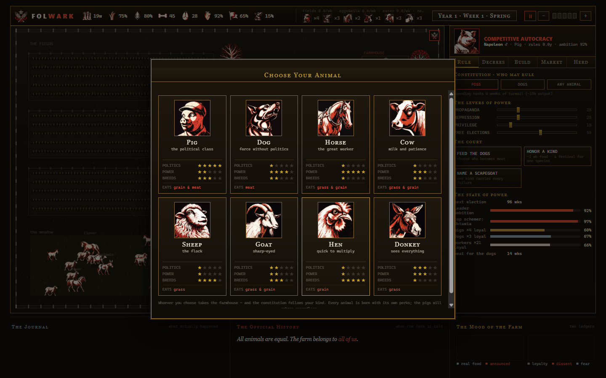
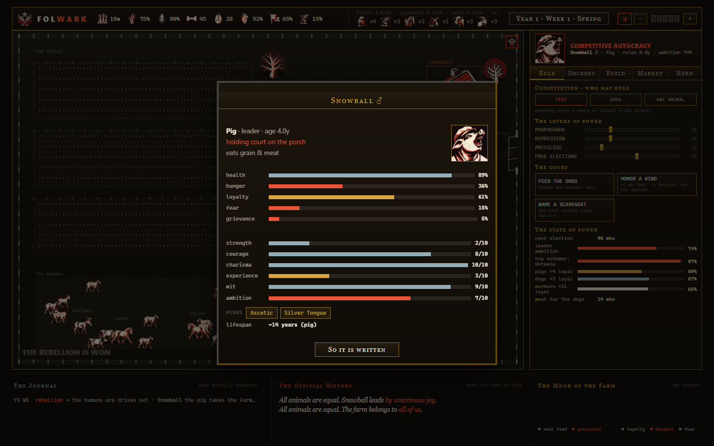

<p align="center">
  
</p>

<p align="center">
  <a href="LICENSE"></a>
  <a href="https://gameowermedia.github.io/FOLWARK/"></a>
  
  
</p>

**FOLWARK** is a political-systems and ecosystem simulator after George Orwell's *Animal Farm*: the humans are gone, you are the unseen hand behind the farmhouse, and every week you decide who rules, who eats, who works and, when the dogs grow hungry, who becomes the meal. Two chronicles are written as you play: the Journal (what actually happened) and the Official History (what the farm is told).

<p align="center">
  
  <br><sub>A leader's card mid-game: every animal is an individual with its own needs, stats and perks.</sub>
</p>

### [Play it now](https://gameowermedia.github.io/FOLWARK/)

## Why

Most strategy games model a society as a few global numbers. FOLWARK models it as a herd of individuals, so the slide from revolution into hierarchy happens animal by animal:

- **Every animal is someone.** Each one has health, hunger, loyalty, fear, grievance, strength, courage, charisma, wit and ambition, plus perks rolled at birth (Born Leader, Silver Tongue, Iron Back, Coward, Glutton and others). Leaders, schemers and scapegoats come out of that, not out of a script.
- **The food is real.** Grain, grass, meat and water regenerate by season and are eaten by species-specific diets. Overgraze the meadow and the hay comes out of the granary; drain the waterhole in summer and thirst spreads.
- **The species do not overlap.** Pigs scheme and form councils, dogs are force that cannot govern, horses are the great workers, hens are dim but multiply fast. Eight species, each with its own stat ranges, diet, breeding rate and a lifespan scaled from the real animal.
- **Power has levers.** Propaganda, repression, privilege and free elections are sliders; the constitution decides which species may rule (pigs, dogs or any animal) and amending it costs weeks of turmoil. The regime is named live from what you set: one-party rule, competitive autocracy, personalist cult, military rule of the dogs and others.
- **History is written twice.** The Journal records what you did; the Official History records the propaganda version. The Mood of the Farm charts both ledgers side by side.

## Play

In the browser: **https://gameowermedia.github.io/FOLWARK/**

Offline: FOLWARK is one self-contained `index.html`. No build step, no dependencies, no network; all art is inlined as data URIs. Download it and open it, or serve it:

```
start index.html               # Windows
open index.html                # macOS
python -m http.server 8199     # any OS, then visit http://localhost:8199
```

## Quick start

1. Click **Begin the Rebellion**.
2. Choose your animal. Its kind takes the farmhouse, the constitution follows it, and you meet your leader's perks when you click the portrait. Each species is rated for **Politics**, **Power** and **Breeds** and shows what it eats.
3. Watch the resource bar and the Mood of the Farm, and act through the five tabs on the right.

Controls: `Space` pauses and resumes, `+` and `-` change the speed, `Esc` cancels placing a building.

## How it works

Time runs in weeks: one tick is one week, a year has 48 weeks in four seasons, and the season sets how fast the land regrows.

| Tab | What you do there |
|---|---|
| **Rule** | the constitution (who may rule), the four levers of power, the Court (feed the dogs, honor a kind, name a scapegoat) and the state of power: next election, leader ambition, the top schemer, loyalty by group |
| **Decrees** | one-off orders of the unseen hand (feast, harvest drive, amnesty, redistribute, depose, snap election), each with a cost and a cooldown |
| **Build** | place one of 13 buildings on the map (windmill, granary, henhouse, cowshed, sick pen, reading yard, kennel, monument, well, hay rick, watchtower, stable, apple trees); each costs food and takes weeks to build |
| **Market** | trade grain at the gate for meat or new animals |
| **Herd** | the census: every animal with its portrait, name, sex, species, role and condition |

Dilemmas interrupt the game when conditions call for them; for example, when meat runs short and an old horse is past its prime, the knacker's cart waits at the gate. Elections, coups, purges and revolutions follow from the animals' loyalty, grievance and ambition, within a population cap of 46.

## FAQ

**Does it need an internet connection?** No. Everything, including the art, is inside `index.html`.

**Is it finished?** It is an experiment in browser-based political simulation; expect balance to change.

## Limitations

- No save game: a session lives as long as the browser tab.
- Made for mouse and keyboard; there is no touch-specific input.
- The interface is English only.

## Credits

Thematic debt to George Orwell's *Animal Farm* (1945). Art generated in a linocut and constructivist style and baked into the page.

## License

[MIT](LICENSE)
